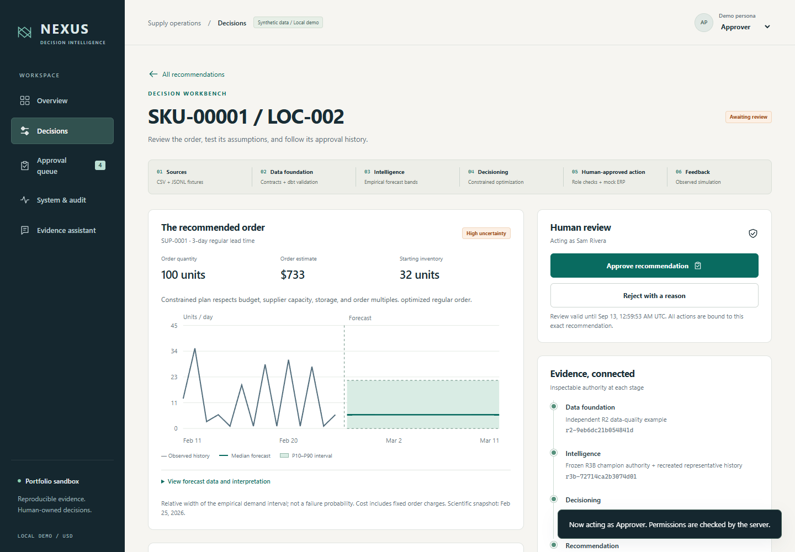

# NEXUS Decision Intelligence

NEXUS helps a supply planner decide how much to reorder when demand is uncertain and budget, supplier capacity, and storage are limited. This local demo follows a replenishment decision from forecast to human approval and simulated outcome.

**[Watch the 4-minute, 22-second walkthrough](docs/portfolio/assets/portfolio-walkthrough.webm).** The recording uses synthetic data and requires no setup.

## One replenishment decision

With 32 units of `SKU-00001` on hand at `LOC-002`, NEXUS recommends ordering 100 units at an estimated cost of $733. The planner reviews the forecast and constraints. A separate approver authorizes that exact recommendation and requests a mock purchase order. An execution retry returns the same order reference, and the audit trail records the execution and simulated outcome.



The [local verification record](docs/portfolio/VERIFICATION.md) covers approval binding, mock execution retries, and the outcome after restart.

## Run the local demo

Use Python 3.12 or 3.13 and [uv](https://docs.astral.sh/uv/getting-started/installation/). From the repository root:

```sh
uv sync --locked --group portfolio --group dev
uv run --group portfolio nexus portfolio prepare --state-dir artifacts/demo-v0.1
uv run --group portfolio nexus portfolio serve --state-dir artifacts/demo-v0.1
```

Open [localhost:8765](http://127.0.0.1:8765). The first preparation validates synthetic sources, runs dbt and optimization, then saves evidence and workflow state. Later starts verify and reuse that state. Keep the same `--state-dir` for `prepare` and `serve`; after governing code or inputs change, choose a new directory so old decisions remain intact. On Windows, use a short checkout path if native DLL path limits arise. On a managed network, uv's `--system-certs` option uses the Windows trust store without disabling certificate checks.

Run an isolated acceptance check without touching the interactive demo:

```sh
uv run --group portfolio nexus portfolio verify
```

## What to show

1. Open a recommendation and inspect its forecast, source lineage, constraints, and scenario costs.
2. Switch from planner to approver and authorize the exact recommendation fingerprint.
3. Execute a **mock** order, retry it, and confirm that only one local effect exists.
4. Inspect the audit trail, delayed simulated outcome, and a firing then resolved freshness incident.
5. Ask the read-only evidence assistant for a cited explanation; ask it to place an order and see the refusal.

The [five-minute demo script](docs/portfolio/DEMO.md) gives the click path. The [case study](docs/portfolio/CASE_STUDY.md) explains the design decisions and the [learning guide](docs/portfolio/LEARNING.md) helps reviewers follow the code.

## Evidence and scope

| Local check | Current observed result |
| --- | --- |
| Portfolio acceptance | 22/22 checks |
| dbt build and tests | 189 PASS, 0 WARN, 0 ERROR |
| Decision solver | OPTIMAL; independently feasible |
| Synthetic source validation | 167 records, 163 accepted, 4 quarantined |
| Example plan | Four recommendations, $2,974 within a $3,600 synthetic budget |
| Locked dependency audit | 180 packages, no known vulnerabilities in the 2026-11-21 local scan |

The default demo reads a frozen, checksum-verified seasonal forecast from the R3B fixture. Its separate R2 data-quality example validates synthetic sources and builds dbt tables. The learned challenger failed its promotion checks, so the seasonal baseline remains in use. The demo uses SQLite state, demo personas, and mock ERP effects. Costs, fill rates, and outcomes are simulated.

The optional [connected runtime](docs/portfolio/CONNECTED_RUNTIME.md) builds fresh Gold tables from validated synthetic inputs and uses them to generate a new 14-day seasonal forecast and constrained plan for human review. The repository also contains gated PostgreSQL, Redpanda, Dagster, MLflow, and recovery experiments. Original distributed G2–G7 scale, recovery, soak, deployment, and prospective model-switch gates remain open. Read the [security boundaries](docs/portfolio/SECURITY.md) before changing deployment settings.

## Optional local AI explanation

The default evidence assistant needs no model. An optional installed [Ollama](https://docs.ollama.com/faq) model can answer questions about the selected current recommendation with governed read-only tools and fictional supplier or policy citations. The server verifies the model digest and its answer against current evidence; neither assistant can approve or execute.

In one PowerShell terminal, start Ollama on loopback with cloud access disabled:

```powershell
$env:OLLAMA_HOST = '127.0.0.1:11435'
$env:OLLAMA_NO_CLOUD = '1'
ollama serve
```

In another terminal, set the same two variables, then run:

```powershell
ollama pull qwen3.5:9b-q4_K_M
uv run --group portfolio nexus portfolio serve --state-dir artifacts/demo-v0.1 --local-model
```

The model is opt-in and has no cloud fallback. The [local AI evaluation](docs/portfolio/LOCAL_COPILOT_TOOLS.md) and [security policy](SECURITY.md) describe its bounds.

## Review and reproduce

The local demo, [case study](docs/portfolio/CASE_STUDY.md), [CI workflow](.github/workflows/ci.yml), and [MIT license](LICENSE) are the shortest review path. Check this repository's Actions result for the exact commit; the optional full service tier is a separate manual gate. Dated planning and gate logs remain in the original private development repository. This reviewer copy has fresh Git history and no inherited PR discussions.
