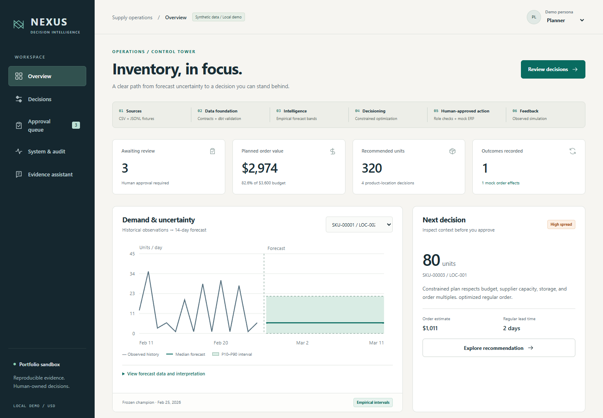

# NEXUS Decision Intelligence

NEXUS turns uncertain demand into replenishment recommendations that a person can inspect, approve, and trace to a simulated outcome. It is a runnable local portfolio project spanning data engineering, forecasting, optimization, and product controls.



**Source data → trusted tables → forecast → constrained plan → human approval → mock order → feedback**

## Run the local demo

Use Python 3.12 or 3.13 and [uv](https://docs.astral.sh/uv/getting-started/installation/). From the repository root:

```sh
uv sync --locked --group portfolio --group dev
uv run --group portfolio nexus portfolio prepare --state-dir artifacts/demo-v0.1
uv run --group portfolio nexus portfolio serve --state-dir artifacts/demo-v0.1
```

Open [localhost:8765](http://127.0.0.1:8765). The first preparation validates synthetic sources, runs dbt and optimization, then saves evidence and workflow state. Later starts verify and reuse that state. Keep the same `--state-dir` for `prepare` and `serve`; after governing code or inputs change, choose a new directory so old decisions remain intact. On Windows, use a short checkout path if native DLL path limits arise. On a managed network, uv's `--system-certs` option uses the Windows trust store without disabling certificate checks.

Run an isolated acceptance check without touching the interactive demo:

```sh
uv run --group portfolio nexus portfolio verify
```

## What to show

1. Open a recommendation and inspect its forecast, source lineage, constraints, and scenario costs.
2. Switch from planner to approver and authorize the exact recommendation fingerprint.
3. Execute a **mock** order, retry it, and confirm that only one local effect exists.
4. Inspect the audit trail, delayed simulated outcome, and a firing then resolved freshness incident.
5. Ask the read-only evidence assistant for a cited explanation; ask it to place an order and see the refusal.

The [five-minute demo script](docs/portfolio/DEMO.md) gives the click path. The [case study](docs/portfolio/CASE_STUDY.md) explains the design decisions and the [learning guide](docs/portfolio/LEARNING.md) helps reviewers follow the code.

## Evidence and scope

| Local check | Current observed result |
| --- | --- |
| Portfolio acceptance | 22/22 checks |
| dbt build and tests | 189 PASS, 0 WARN, 0 ERROR |
| Decision solver | OPTIMAL; independently feasible |
| Synthetic source validation | 167 records, 163 accepted, 4 quarantined |
| Example plan | Four recommendations, $2,974 within a $3,600 synthetic budget |
| Locked dependency audit | 180 packages, no known vulnerabilities in the 2026-11-21 local scan |

The default demonstration uses synthetic data, a frozen checksum-verified seasonal champion, SQLite state, demo personas, and mock ERP effects. The learned challenger failed its promotion checks and remains out of service. The R2 data-quality example and frozen R3B forecast fixture have separate provenance; no join between them is invented. Costs, fill rates, and outcomes are simulations, not measured customer savings.

A separate [connected runtime](docs/portfolio/CONNECTED_RUNTIME.md) links fresh Gold tables to a seasonal forecast and a new approval-safe plan. The repository also contains gated PostgreSQL, Redpanda, Dagster, MLflow, and recovery experiments. Those paths do not turn this local release into a production service. Original distributed G2–G7 scale, recovery, soak, deployment, and prospective model-switch gates remain open. Read the [security boundaries](docs/portfolio/SECURITY.md) before changing deployment settings.

## Optional local AI explanation

The default evidence assistant needs no model. An optional installed [Ollama](https://docs.ollama.com/faq) model can answer questions about the selected current recommendation with governed read-only tools and fictional supplier or policy citations. The server verifies the model digest and its answer against current evidence; neither assistant can approve or execute.

In one PowerShell terminal, start Ollama on loopback with cloud access disabled:

```powershell
$env:OLLAMA_HOST = '127.0.0.1:11435'
$env:OLLAMA_NO_CLOUD = '1'
ollama serve
```

In another terminal, set the same two variables, then run:

```powershell
ollama pull qwen3.5:9b-q4_K_M
uv run --group portfolio nexus portfolio serve --state-dir artifacts/demo-v0.1 --local-model
```

The model is opt-in and has no cloud fallback. The [local AI evaluation](docs/portfolio/LOCAL_COPILOT_TOOLS.md) and [security policy](SECURITY.md) describe its bounds.

## Review and reproduce

The local demo, [case study](docs/portfolio/CASE_STUDY.md), [CI workflow](.github/workflows/ci.yml), and [MIT license](LICENSE) are the shortest review path. Check this repository's Actions result for the exact commit; the optional full service tier is a separate manual gate. Dated planning and gate logs remain in the original private development repository. This reviewer copy has fresh Git history and no inherited PR discussions.
