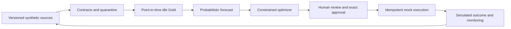

# NEXUS data and decision lifecycle

1. **Sources and trust.** CSV and JSONL fixtures carry declared identities and checksums. Validation quarantines invalid or duplicate records rather than hiding them. Point-in-time transforms use information available at the decision cutoff.
2. **Forecast and plan.** The frozen demo verifies a seasonal champion artifact before generating proposals. A separate connected mode builds a fresh seasonal forecast from the validated Gold snapshot. Both feed constrained replenishment decisions with an independent feasibility check.
3. **Human control.** Recommendations are proposals. The server checks role, location, expiry, current generation, and exact fingerprint before approval; a different identity must approve. Execution writes only a mock local effect and is safe to retry within this sandbox.
4. **Feedback.** Simulated outcomes, audit events, and a local incident journal survive restart. The connected mode can invalidate stale advice and queue replanning. The learning experiment remains separate and does not automatically promote a model.

The [case study](../portfolio/CASE_STUDY.md) explains the engineering choices. The [demo](../portfolio/DEMO.md), [connected runtime guide](../portfolio/CONNECTED_RUNTIME.md), and [security boundaries](../portfolio/SECURITY.md) show the executable paths and limits. No stage implies a production identity provider, real ERP integration, or completed distributed G2-G7 gates.
